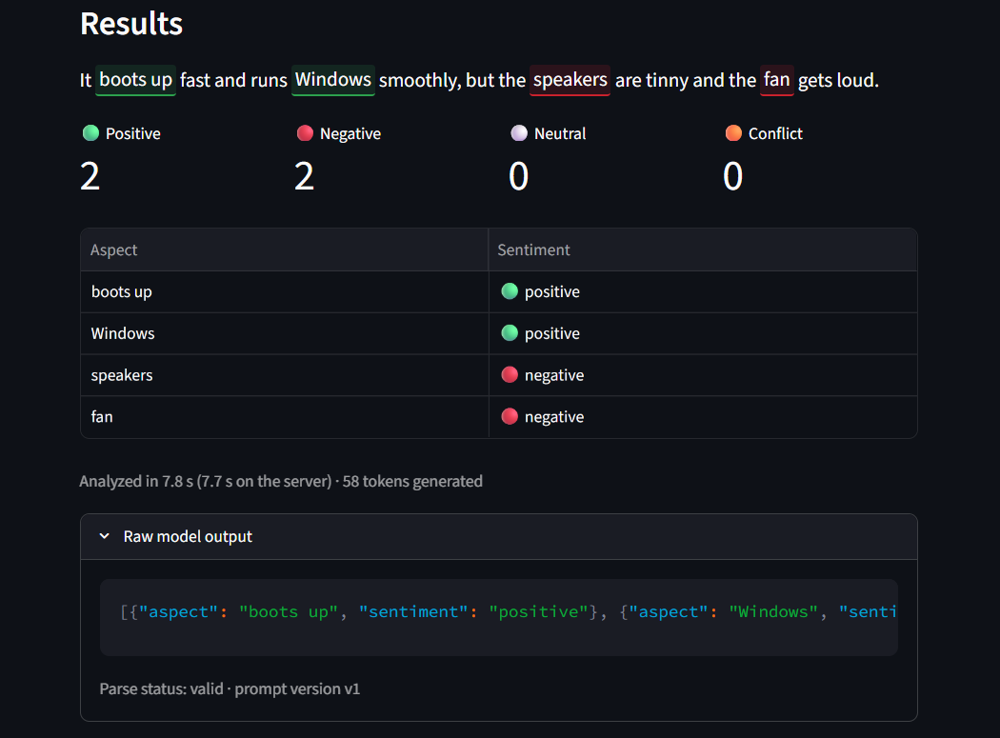
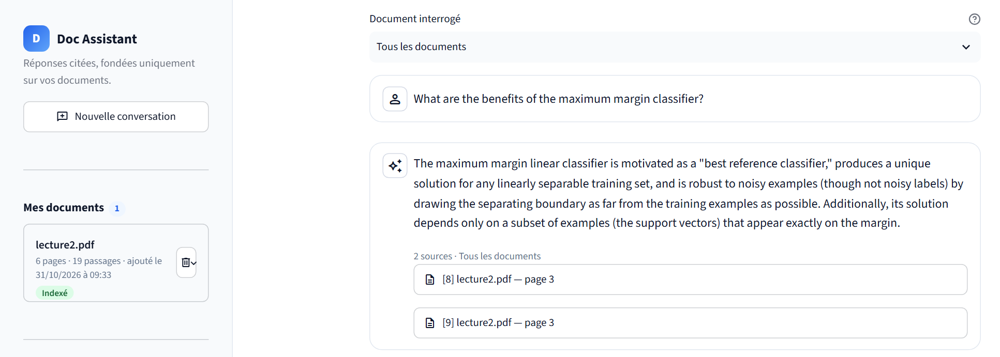

<h1 align="center">Elie Chahoud</h1>

  <strong>Master 2 AI & Data Science student · AI &amp; Machine Learning</strong> 
  Data Science · Generative AI · MLOps

  
  
  

  🎯 <strong>**Looking for an AI / Machine Learning / Data Science internship starting February 2027 in France.**
</strong>

---

## About me

I build end-to-end machine learning systems, from data pipelines and model training to serving, monitoring and evaluation. My projects cover computer vision, LLM fine-tuning, retrieval-augmented generation and financial risk modelling. They share one principle: **honest evaluation**. That means held-out test sets scored once, leakage checks, reproducible pipelines, and limitations stated clearly next to the results.

## Education

**Master 2 Informatique pour la Science des Données (ISD)** — Université Paris-Saclay
Double-degree program with **Saint Joseph University of Beirut (USJ)**

## Technical skills

| Area | Tools |
|---|---|
| **Languages & data** | Python, pandas, NumPy, scikit-learn, Plotly |
| **Machine & deep learning** | PyTorch, torchvision (transfer learning), XGBoost, logistic regression, cross-validation |
| **Generative AI & LLMs** | Hugging Face Transformers, PEFT / QLoRA, TRL, bitsandbytes, LangChain, LangGraph, Ollama, Google Gemini |
| **Retrieval & RAG** | sentence-transformers, cross-encoder reranking, FAISS, ChromaDB, retrieval evaluation (hit@k, MRR) |
| **MLOps & deployment** | MLflow, DVC, FastAPI, Docker / Compose, GitHub Actions, Prometheus, Grafana, Evidently |
| **Apps & testing** | Streamlit, pytest |

---

## Featured projects

### 🖼️ DeepVision — End-to-end MLOps for image classification

A six-class scene classifier (ResNet-18 transfer learning) packaged with the tooling to train, track, serve and monitor it.

- **Held-out clean test (2,997 images):** macro-F1 **0.940** (95% CI 0.932–0.948), accuracy **0.939**
- **Pipeline:** DVC stages `extract → audit → split → train → evaluate → drift`, with experiments tracked in MLflow
- **Serving & ops:** FastAPI inference API and Streamlit client in hardened Docker containers, Prometheus metrics with unit-tested alert rules, Grafana dashboard, CI on GitHub Actions
- **Drift monitoring:** Evidently compares unlabelled images with validation data. It found no drift on real data and flagged simulated darkening and blur

**Limitations:** the main remaining confusions are mountain ↔ glacier and street ↔ buildings. The API has no authentication and is designed to run on localhost only.

`PyTorch` `MLflow` `DVC` `FastAPI` `Streamlit` `Docker` `GitHub Actions` `Prometheus` `Grafana` `Evidently`

**[Repository →](https://github.com/eliechahoud7/deepvision-mlops)**

---

### 💬 Customer Feedback Intelligence — LLM fine-tuning for aspect-based sentiment

QLoRA fine-tuning of **Qwen2.5-3B-Instruct** to extract every product aspect in a review and classify the sentiment toward each one as structured JSON, in a single generation.

**Held-out test split** (222 reviews, 360 aspects; same prompt, parser and metrics for both models):

| Metric | Zero-shot baseline | Fine-tuned (QLoRA) |
|---|---:|---:|
| Aspect F1 | 36.18% | **85.55%** |
| Aspect + sentiment F1 | 30.92% | **73.77%** |
| Valid JSON responses | — | 222 / 222 |

- **Evaluation discipline:** checkpoint selected on validation only, test split scored once, leakage-checked review-level splits with SHA-256 checksums, 280+ pytest tests
- **Deployment:** token-protected FastAPI GPU service (Kaggle / Colab T4) behind a Cloudflare tunnel, with a Streamlit front end

**Context & limitations:** scores come from the final Colab evaluation run. Model weights and evaluation outputs are not committed, so they can't be recomputed from the repository alone. The model was trained on short SemEval-2014 laptop reviews and invented 5 aspects on the test split. The [live app](https://customer-feedback-intelligence-amgrz9rariauf2k7jff2t8.streamlit.app/) only works while the GPU backend is running.

`Transformers` `PEFT` `TRL` `bitsandbytes` `FastAPI` `Streamlit` `pytest`

**[Repository →](https://github.com/eliechahoud7/customer-feedback-intelligence)**

---

### 📉 AI Financial Crisis Detector — Offline financial risk research system

A local, CPU-only research system combining market-stress scoring, company-distress classification, a grounded RAG assistant and a LangGraph workflow in a Streamlit dashboard. It needs no paid APIs or cloud services.

- **Company distress, held-out test (1,364 companies, 44 positives):** XGBoost average precision **0.487**, ROC-AUC **0.958** (base-rate AP 0.032)
- **Market stress, held-out test 2015–2026:** every model beat the base rate (AP 0.212), but the signal is **weak**. The best result came from a simple downside-volatility rule (AP 0.363), and no fitted model clearly beat it
- **Rigour:** chronological splits with purge gaps, frozen checksum-verified artifacts, ~380 tests, 37 documented design decisions (D1–D37)
- **RAG assistant:** cited answers with grounding checks; it refuses when the evidence is insufficient

**Limitations:** this is a research and educational project, not a forecasting tool or financial advice. Company-distress labels are undocumented in the source dataset, so those results are classification performance, not confirmed bankruptcy predictions. RAG retrieval metrics (hit@5 0.846) come from the development set only and are optimistic.

`scikit-learn` `XGBoost` `LangGraph` `LangChain` `FAISS` `sentence-transformers` `Ollama` `Streamlit` `Plotly`

**[Repository →](https://github.com/eliechahoud7/AI-Financial-Crisis-Detector)**

---

### 📄 Intelligent Document Assistant — Bilingual RAG over PDFs

A French/English question-answering assistant for PDF documents. It answers only from retrieved passages, cites the real file and page, and abstains when the documents don't contain the answer.

- **Pipeline:** page-aware chunking → multilingual-e5-small embeddings → ChromaDB → Google Gemini with JSON-constrained output; citations are rebuilt from real chunk metadata, never taken from the model's text
- **Engineering:** ports-and-adapters architecture, 10 architecture decision records, reproducible retrieval and generation evaluation harness
- **Preliminary evaluation (20 EN/FR questions):** 14/15 answerable questions correct, 5/5 unanswerable questions correctly rejected, citation precision 100%, citation recall 94.74%

**Context:** the evaluation set is small and self-annotated, and scoring is automatic, partly keyword-based, and not human-reviewed. Treat these results as indicative, not a benchmark.

`RAG` `ChromaDB` `sentence-transformers` `Google Gemini` `Streamlit` `pytest`

**[Repository →](https://github.com/eliechahoud7/document-assistant-rag)** · **[Live demo →](https://document-assistant-rag-elie.streamlit.app)**

---

  <a href="https://www.linkedin.com/in/eliechahoudd/">LinkedIn</a> ·
  <a href="https://github.com/eliechahoud7">GitHub</a> ·
  <a href="mailto:elie.chahoud70@gmail.com">elie.chahoud70@gmail.com</a>

