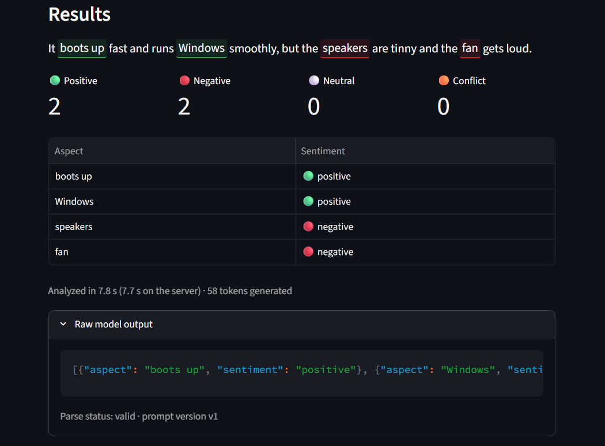
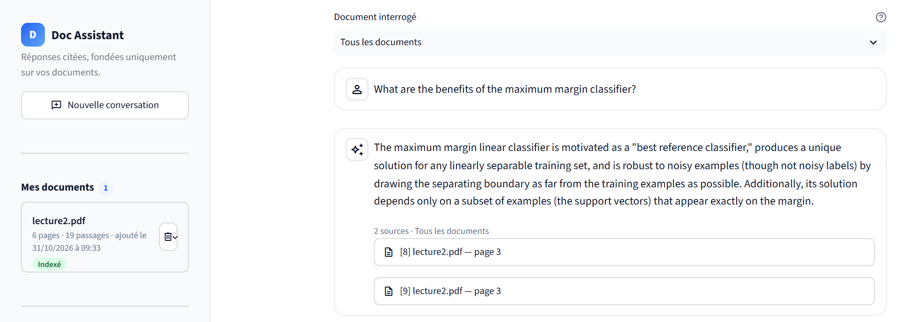

<h1 align="center">Elie Chahoud</h1>

  <strong>Master's Student in AI & Data Science · Université Paris-Saclay</strong> 
  Artificial Intelligence · Machine Learning · Generative AI · Data Science · Data Engineering · MLOps

  
  
  

  🎯 <strong>Seeking an internship in these fields, starting February 2027 in France.</strong>

---

## About me

I build end-to-end data and AI solutions, combining machine learning, generative AI, data engineering and analytics to solve real-world problems. My work spans the full data lifecycle, from collecting and transforming data to building predictive models, designing data platforms, deploying applications and evaluating their performance.

My projects cover a broad range of domains, including computer vision, LLM fine-tuning, retrieval-augmented generation, financial risk analysis, geospatial intelligence, data warehousing, predictive analytics and business intelligence. I work with technologies such as Python, PyTorch, Hugging Face Transformers, LangChain, PostgreSQL, PostGIS, Databricks, dbt, Airflow, PySpark and Power BI.

Across all my projects, I emphasize rigorous evaluation, reproducibility and engineering quality: validating data, preventing leakage, comparing models against meaningful baselines, building reliable pipelines and communicating limitations transparently.

## 🌐 My Portfolio

Explore my projects, technical skills, and experience:

[**View My Portfolio →**](https://elie-chahoud-portfolio.vercel.app/)

## Education

**Master 2 — Informatique pour la Science des Données (ISD)** — Université Paris-Saclay
Double-degree program with **Saint Joseph University of Beirut (USJ)**

## Technical skills

Technologies I have used in the projects below:

| Area | Tools |
|---|---|
| **Programming languages** | Python, SQL |
| **AI & machine learning** | PyTorch, torchvision (transfer learning), scikit-learn, XGBoost, logistic regression, random forests, K-Means, cross-validation, SHAP |
| **Generative AI & NLP** | Hugging Face Transformers, PEFT / QLoRA, TRL, bitsandbytes, LangChain, LangGraph, Ollama, Google Gemini |
| **Retrieval & RAG** | sentence-transformers, cross-encoder reranking, FAISS, ChromaDB, retrieval evaluation (hit@k, MRR) |
| **Data engineering** | Databricks (Delta Lake, Unity Catalog), dbt, Apache Airflow, PySpark, layered pipelines with checksums and data-quality checks |
| **Data science & analytics** | pandas, NumPy, SciPy, statsmodels, GeoPandas, Shapely, time-series forecasting |
| **Databases** | PostgreSQL, PostGIS, Databricks SQL |
| **MLOps & deployment** | MLflow, DVC, FastAPI, Docker / Compose, GitHub Actions, Prometheus, Grafana, Evidently |
| **Apps, visualization & testing** | Streamlit, Power BI, Plotly, Matplotlib, Jupyter, pytest |

---

## Projects

### 🖼️ DeepVision — End-to-end MLOps for image classification

A six-class scene classifier (ResNet-18 transfer learning) packaged with the tooling to train, track, serve and monitor it.

- **Held-out clean test (2,997 images):** macro-F1 **0.940** (95% CI 0.932–0.948), accuracy **0.939**
- **Pipeline:** DVC stages `extract → audit → split → train → evaluate → drift`, with experiments tracked in MLflow
- **Serving & ops:** FastAPI inference API and Streamlit client in hardened Docker containers, Prometheus metrics with unit-tested alert rules, Grafana dashboard, CI on GitHub Actions
- **Drift monitoring:** Evidently compares unlabelled images with validation data. It found no drift on real data and flagged simulated darkening and blur

**Limitations & Future Work:** the main remaining confusions are mountain ↔ glacier and street ↔ buildings. The API has no authentication and is designed to run on localhost only. Next steps: add authentication and TLS before any network exposure, log live inputs for drift monitoring, and add embedding-based drift detection.

`PyTorch` `MLflow` `DVC` `FastAPI` `Streamlit` `Docker` `GitHub Actions` `Prometheus` `Grafana` `Evidently`

**[Repository →](https://github.com/eliechahoud7/deepvision-mlops)**

---

### 💬 Customer Feedback Intelligence — LLM fine-tuning for aspect-based sentiment

QLoRA fine-tuning of **Qwen2.5-3B-Instruct** to extract every product aspect in a review and classify the sentiment toward each one as structured JSON, in a single generation.

**Held-out test split** (222 reviews, 360 aspects; same prompt, parser and metrics for both models):

| Metric | Zero-shot baseline | Fine-tuned (QLoRA) |
|---|---:|---:|
| Aspect F1 | 36.18% | **85.55%** |
| Aspect + sentiment F1 | 30.92% | **73.77%** |
| Valid JSON responses | — | 222 / 222 |

- **Evaluation discipline:** checkpoint selected on validation only, test split scored once, leakage-checked review-level splits with SHA-256 checksums, 280+ pytest tests
- **Deployment:** token-protected FastAPI GPU service (Kaggle / Colab T4) behind a Cloudflare tunnel, with a Streamlit front end

**Limitations & Future Work:** scores come from the final Colab evaluation run. Model weights and evaluation outputs are not committed, so they can't be recomputed from the repository alone. The model was trained on short SemEval-2014 laptop reviews and invented 5 aspects on the test split. The [live app](https://customer-feedback-intelligence-amgrz9rariauf2k7jff2t8.streamlit.app/) only works while the GPU backend is running. Next steps: move the API to an always-on GPU host or a named Cloudflare tunnel for a stable URL, add aspect-free and out-of-domain training examples, and report bootstrap confidence intervals.

`Transformers` `PEFT` `TRL` `bitsandbytes` `FastAPI` `Streamlit` `pytest`

**[Repository →](https://github.com/eliechahoud7/customer-feedback-intelligence)**

---

### 📉 Financial Crisis Detector — Offline financial risk research system

A local, CPU-only research system combining market-stress scoring, company-distress classification, a grounded RAG assistant and a LangGraph workflow in a Streamlit dashboard. It needs no paid APIs or cloud services.

- **Company distress, held-out test (1,364 companies, 44 positives):** XGBoost average precision **0.487**, ROC-AUC **0.958** (base-rate AP 0.032)
- **Market stress, held-out test 2015–2026:** every model beat the base rate (AP 0.212), but the signal is **weak**. The best result came from a simple downside-volatility rule (AP 0.363), and no fitted model clearly beat it
- **Rigour:** chronological splits with purge gaps, frozen checksum-verified artifacts, ~380 tests, 37 documented design decisions (D1–D37)
- **RAG assistant:** cited answers with grounding checks; it refuses when the evidence is insufficient

**Limitations & Future Work:** this is a research and educational project, not a forecasting tool or financial advice. Company-distress labels are undocumented in the source dataset, so those results are classification performance, not confirmed bankruptcy predictions. RAG retrieval metrics (hit@5 0.846) come from the development set only and are optimistic. Next steps: test new models on market data collected after the frozen snapshot, calibrate the company-distress probabilities, and confirm the RAG metrics on a new held-out question set.

`scikit-learn` `XGBoost` `LangGraph` `LangChain` `FAISS` `sentence-transformers` `Ollama` `Streamlit` `Plotly`

**[Repository →](https://github.com/eliechahoud7/AI-Financial-Crisis-Detector)**

---

### 📄 Intelligent Document Assistant — Bilingual RAG over PDFs

A French/English question-answering assistant for PDF documents. It answers only from retrieved passages, cites the real file and page, and abstains when the documents don't contain the answer.

- **Pipeline:** page-aware chunking → multilingual-e5-small embeddings → ChromaDB → Google Gemini with JSON-constrained output; citations are rebuilt from real chunk metadata, never taken from the model's text
- **Engineering:** ports-and-adapters architecture, 10 architecture decision records, reproducible retrieval and generation evaluation harness
- **Preliminary evaluation (20 EN/FR questions):** 14/15 answerable questions correct, 5/5 unanswerable questions correctly rejected, citation precision 100%, citation recall 94.74%

**Limitations & Future Work:** the evaluation set is small and self-annotated, and scoring is automatic, partly keyword-based, and not human-reviewed. Treat these results as indicative, not a benchmark. Next steps: confirm the generation results on an independent question set with repeated runs and human review, and add optional OCR for scanned PDFs.

`RAG` `ChromaDB` `sentence-transformers` `Google Gemini` `Streamlit` `pytest`

**[Repository →](https://github.com/eliechahoud7/document-assistant-rag)** · **[Live demo →](https://document-assistant-rag-elie.streamlit.app)**

---

### 🚦 Road Safety Intelligence — Geospatial road-accident analysis for France

A reproducible pipeline on the official French road-accident database (BAAC, ONISR, 2019–2025). It covers checksummed data acquisition, data-quality profiling, geographic validation against IGN boundaries, a PostgreSQL/PostGIS warehouse, statistical and geospatial hotspot analysis, and a Streamlit dashboard.

- **Scale & quality:** 361,593 injury accidents in metropolitan France, 99.8% with exact or ≤ 500 m validated coordinates, 509 automated validation checks
- **Hotspots:** 1% of non-empty 1 km cells hold 32.5% of accidents but only 6.2% of fatal accidents
- **Severity:** night accidents are about twice as often fatal (10.0% vs 5.2%), and accidents outside built-up areas are 3.5× as often fatal (10.3% vs 3.0%; Cramér's V = 0.26)
- **Warehouse:** layered PostGIS schema (staging → clean → analytics) with lineage and no double counting across one-to-many tables, served to a six-section Streamlit dashboard

**Limitations & Future Work:** results describe police-recorded injury accidents and where they concentrate, not risk, because no traffic-volume (exposure) data is available. The analysis is descriptive only, with no causal claims or predictive modelling. Next steps: integrate traffic-volume data to estimate risk, apply the documented coordinate corrections, and extend the pipeline to new BAAC releases.

`PostgreSQL` `PostGIS` `GeoPandas` `Shapely` `SciPy` `Streamlit` `Docker`

**[Repository →](https://github.com/eliechahoud7/road-safety-intelligence)**

---

### 🎓 Career Intelligence — Databricks data platform for career guidance

A data platform that integrates six official French open datasets (ROME, ONISEP, Formacode, BMO and others) into a Databricks Bronze → Silver → Gold → Search model. It serves the data through a French-language Streamlit app for searching occupations, skills and training paths.

- **Integration:** 39 Bronze Delta tables (one per source file), refined through Silver and Gold layers without inventing relationships between sources
- **Serving:** 22 read-only SQL query contracts behind four application pages
- **Validation:** 622 offline tests and 55 live Databricks tests passed; 325/325 SQL data-quality checks pass

**Limitations & Future Work:** the project runs on Databricks Free Edition and the application runs locally, with no public deployment. BMO recruitment figures are minimums because of statistical secrecy, and ONISEP training links cover 392 of the 1,923 ROME occupations. Next steps: move to a platform whose terms allow public deployment, expose DARES data once its licence is confirmed, and schedule refreshes when sources publish new releases.

`Databricks` `Delta Lake` `Unity Catalog` `SQL` `Streamlit` `pytest`

**[Repository →](https://github.com/eliechahoud7/career-intelligence)**

---

### 🛒 Retail Intelligence — End-to-end e-commerce analytics platform

An end-to-end analytics project on the Olist Brazilian e-commerce dataset (about 100,000 orders, 2016–2018). It builds a checksummed, layered pipeline into a PostgreSQL star schema with dbt marts, PySpark workloads and an Airflow DAG. On top of that come customer analytics, predictive modelling, forecasting, SHAP explanations and five Power BI dashboards validated against the warehouse.

- **Warehouse:** PostgreSQL star schema with 7 analytics views, 20 parameterised SQL queries and 5 tested dbt marts; PySpark workloads and an idempotent Airflow DAG
- **Delivery-time regression (random forest):** MAE 4.37 days, 17% better than the median baseline
- **14-day order-volume forecast (Holt-Winters):** WAPE 0.214, 6.9% better than the seasonal-naive baseline
- **BI:** five Power BI dashboards with every page KPI, slicer and drill-through cross-checked against PostgreSQL

**Limitations & Future Work:** the data is observational, so findings are descriptive and SHAP explains the models, not causes. Orders after 21 August 2018 are incomplete in the Olist extract. Late-delivery classification is weak (PR-AUC 0.088 against a 4.40% base rate). Next steps: containerise PostgreSQL, Airflow and Spark, add CI for the unit tests and `dbt build`, and persist and version the trained models (for example with MLflow).

`PostgreSQL` `dbt` `PySpark` `Apache Airflow` `scikit-learn` `statsmodels` `SHAP` `Power BI`

**[Repository →](https://github.com/eliechahoud7/retail-intelligence)**

---

  <a href="https://www.linkedin.com/in/eliechahoudd/">LinkedIn</a> ·
  <a href="https://github.com/eliechahoud7">GitHub</a> ·
  <a href="mailto:elie.chahoud70@gmail.com">elie.chahoud70@gmail.com</a>

